# Appearance: themes, modes, and official packages

Status: theme families 2026-11-21. Part of the [UI layer](ui-layer.md).

A **theme** is a design family. **System / Light / Dark** is a mode *inside* a
theme, not a sibling of it. A theme that provides both light and dark offers
System; a theme with one appearance has no mode control and no System.

- **Jouzu** is the built-in family. Its dark and light halves are the original
  themes, unchanged in `src/styles.css`.
- **Editorial** is the added family. Its dark variant is Nocturne, its light
  variant is Folio. Both are editorial: serif assistant prose, a sans margin
  note for the person, ruled transcript, square surfaces, numbered settings.
- **Moss** in `docs/design/theme-package.example.json` is a single dark
  variant, so it proves the rule: Theme = Moss, no Mode, no System.

## 1. The two levels

| Theme | Light | Dark | Modes offered |
|---|---|---|---|
| Jouzu | Original Light | Original Dark | System, Light, Dark |
| Editorial | Folio | Nocturne | System, Light, Dark |
| Moss (official example) | — | Moss | Dark only; no Mode control |

The appearance card has a **Theme** select, and a **Mode** select only while the
selected theme has more than one variant.

## 2. Layout

```text
src/themes/
  types.ts                    ThemePlugin / ThemePackage; variants
  builtin.ts                  Jouzu: the original light/dark pair
  registry.ts                 discovery, modes, applyTheme, official install API
  registry.test.ts            family/variant rules and System resolution
  installed.ts                official package validation, storage, <style> injection
  installed.test.ts           package validation
  shared/folio.css            Editorial structure (both variants)
  shared/semantic.css         status colours and code tokens for plugin themes
  plugins/
    editorial/theme.ts        family descriptor
    editorial/dark.css        `:root[data-theme="editorial"][data-mode="dark"]`
    editorial/light.css       `:root[data-theme="editorial"][data-mode="light"]`
```

`registry.ts` runs one `import.meta.glob("./plugins/*/theme.ts", { eager: true })`.
A plugin is a family with `variants.light` and/or `variants.dark`. Everything
else asks the registry:

- `themeChoices()` is the Theme select: Jouzu, then build-time families, then
  officially installed families;
- `themeModes(theme)` is the Mode list; one entry means no Mode control;
- `readAppearance()` reads `jouzu.ui.theme` and `jouzu.ui.mode`;
- `applyTheme(theme, mode)` resolves System against the OS, then against the
  family's variants;
- `installTheme` / `removeInstalledTheme` are the official channel's API.

`main.tsx` calls `loadInstalledThemes` before `applyTheme`, so an official theme
is injected and applied before the first paint.

## 3. Contract

A build-time theme is a `ThemePlugin`; an official package is a `ThemePackage`.
Both describe a family, never a single mode.

| Field | Meaning |
|---|---|
| `id` | Stored in `jouzu.ui.theme`. Lowercase letters, digits and dashes. Unique; the built-in id is reserved. |
| `labels` | `en`, `ja`, `zh-Hans`, `zh-Hant`. Build-time themes need all four; a package needs `en` and the rest fall back to it. |
| `style` | Shared structure. `folio` is the Editorial base. |
| `order` | Theme select position after Jouzu. Lower comes first. |
| `variants` | `light` and/or `dark`. At least one. This is what decides whether System exists. |
| `variants.*.css` | Packages only: the stylesheet for that variant. |

A build-time family:

```ts
import type { ThemePlugin } from "../../types";
import "./dark.css";
import "./light.css";

const editorial: ThemePlugin = {
  id: "editorial",
  labels: { en: "Editorial", ja: "エディトリアル", "zh-Hans": "编辑排版", "zh-Hant": "編輯排版" },
  style: "folio",
  order: 10,
  variants: { dark: { mode: "dark" }, light: { mode: "light" } },
};

export default editorial;
```

The variant CSS is scoped to the family and the resolved mode:

```css
:root[data-theme="editorial"][data-mode="dark"] { --color-background: #14110d; }
:root[data-theme="editorial"][data-mode="light"] { --color-background: #f3ede2; }
```

A malformed or duplicate build-time family is skipped with a console warning;
`registry.test.ts` fails when `themePluginIssues` is not empty.

## 4. Adding a build-time family

1. Create `src/themes/plugins/<id>/theme.ts` with one or two variants.
2. Create one CSS file per variant. Each is scoped to
   `:root[data-theme="<id>"][data-mode="light|dark"]`.
3. Set `style: "folio"` to reuse the Editorial structure and supply its tokens:
   - surfaces: `--color-background`, `--color-card`, `--color-popover`,
     `--color-muted`, `--color-accent`, `--color-border`, `--color-input`,
     `--color-foreground`, `--color-muted-foreground`;
   - marks: `--color-primary`, `--color-primary-foreground`,
     `--color-ring`, `--color-brand-soft`;
   - action: `--color-action`, `--color-action-foreground`;
   - status: `--color-warning`, `--color-success`, `--color-destructive`,
     `--color-info`;
   - syntax: `--color-syntax-*`;
   - shape: `--radius-*` (0 for Editorial), `--shadow-*` (`none`),
     `--scrollbar-thumb`, `--scrollbar-thumb-hover`.
4. Build. The Theme select, Mode list, storage validation, first paint and the
   screenshot spec discover the family automatically.

A family with only `dark` has no Mode control. A family with a different
structure omits `style` and writes its own CSS.

## 5. Official theme packages

The official installer writes one validated family. The app has no manual file
picker; the menu and first paint read what the official channel installed.

```json
{
  "schema": 1,
  "id": "moss",
  "labels": { "en": "Moss", "ja": "モス", "zh-Hans": "苔色", "zh-Hant": "苔色" },
  "style": "folio",
  "order": 30,
  "variants": {
    "dark": {
      "css": ":root[data-theme=\"moss\"][data-mode=\"dark\"] { --color-background: #101712; ... }"
    }
  }
}
```

A two-variant package adds `variants.light`; then the app offers System, Light
and Dark. A one-variant package (the example) has no Mode control.

`docs/design/theme-package.example.json` is the working example; it is the
green-tinted Editorial shown in `screenshots/runtime-theme.png` and
`screenshots/appearance-single-mode.png`.

**Storage.** The family id is `jouzu.ui.theme`; the mode is `jouzu.ui.mode`.
Packages are `jouzu.ui.themes`. The CSS is injected as
`<style data-jouzu-theme="<id>">` before the first paint on the next start.

**Validation.** `installTheme` rejects a package when:

- the id is invalid, built-in, already installed, or the tenth family;
- `mode`/labels are missing, or no variant is present;
- a variant CSS is empty, over 256 KB, or does not mention its `data-theme`;
- the CSS contains `@import` or a `url()` with `http:`, `https:`, `//`, `file:`
  or `javascript:`.

**Trust.** A package is CSS only: no JavaScript, no HTML insertion; the CSS is
set with `textContent`. The Content Security Policy blocks remote images and
fonts. A stylesheet can still draw over the window or hide a control, so the
official channel must only distribute packages it has reviewed.

## 6. Scoping and stable hooks

Plugin CSS is scoped to `:root[data-theme="<family>"][data-mode="light|dark"]`.
The Editorial structure is scoped to `:root[data-theme-style="folio"]`. Jouzu
adds no `data-theme` at all; its light mode is the original `.light` class.

Core exposes these hooks for theme CSS:

| Hook | What it is |
|---|---|
| `[data-slot="button"][data-variant="default"]` | The primary action. |
| `[data-slot="input"]`, `[data-slot="select-trigger"]` | Form controls. |
| `[data-slot="dialog-content"]`, `[data-slot="dialog-title"]` | Dialogs. |
| `[data-slot="tabs-trigger"][data-state="active"]` | Active settings tab. |
| `[data-session-selected]` | Selected session row. |
| `[data-slot="sidebar"]`, `[data-slot="session-header"]` | Contents rail and session line. |
| `[data-slot="conversation"]`, `[data-slot="conversation-column"]` | Transcript and reading measure. |
| `[data-slot="assistant-message"]`, `[data-slot="user-message"]`, `[data-slot="user-label"]` | The two voices. |
| `[data-slot="markdown"]`, `[data-slot="code-block"]` | Prose and code. |
| `[data-slot="message-composer"]`, `[data-slot="composer-frame"]` | The ruled composer. |
| `[data-slot="hero"]` | The empty-session title page. |
| `[data-slot="onboarding-cover"]`, `[data-slot="onboarding-glow"]` | First-run cover and its glow. |
| `.onboarding-card` | First-run setup card. |

## 7. Editorial tokens

| Token | Nocturne (Editorial dark) | Folio (Editorial light) | Use |
|---|---|---|---|
| `--color-background` | `#14110d` | `#f3ede2` | Page canvas |
| `--color-card` | `#1b1712` | `#faf5eb` | Sheets, composer, rail |
| `--color-popover` | `#231e18` | `#fffbf3` | Menus and popovers |
| `--color-muted` | `#1f1a14` | `#ece4d6` | Quiet fills, code |
| `--color-accent` | `#2a231b` | `#e5dac8` | Hover, active tab |
| `--color-border` | `#342c23` | `#d6cbbb` | Hairlines |
| `--color-input` | `#5b4e3f` | `#9a8d7a` | Control rule |
| `--color-foreground` | `#ede4d6` | `#231d17` | Body text |
| `--color-muted-foreground` | `#a99e8e` | `#6b6255` | Secondary text |
| `--color-action` | `#ede4d6` | `#241e18` | Primary button |
| `--color-primary` | `#d9a85c` | `#a63d2a` | Rules, labels, links, focus |
| `--color-brand-soft` | `#2b2218` | `#efe0d2` | Selected row wash |
| `--color-warning` | `#e3b676` | `#8a5a00` | Warning |
| `--color-success` | `#8fc7a3` | `#2f6b4f` | Success |
| `--color-destructive` | `#e89a8f` | `#a62b1f` | Failure |

Body text is about 14:1; secondary text and the rule colours clear 4.5:1 in both
variants.

## 8. Screenshots

| Theme | Mode | Conversation | Appearance |
|---|---|---|---|
| Jouzu | Dark | 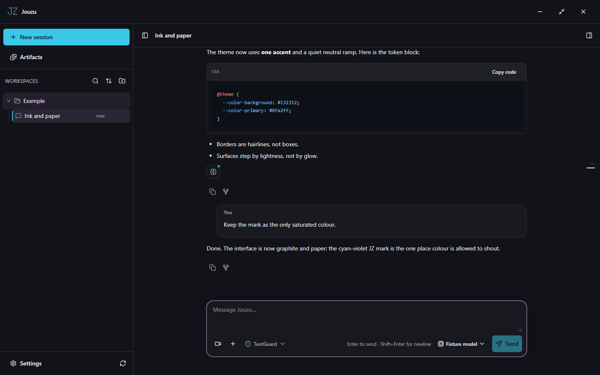 | 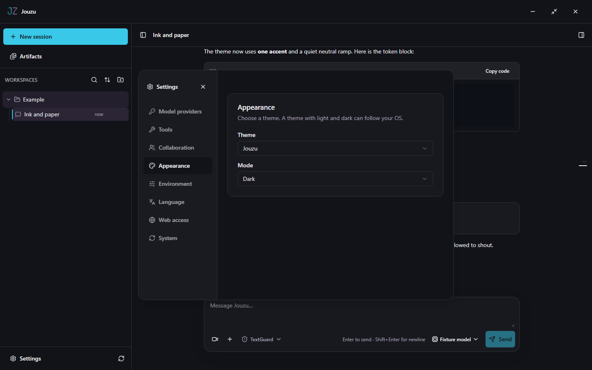 |
| Jouzu | Light | 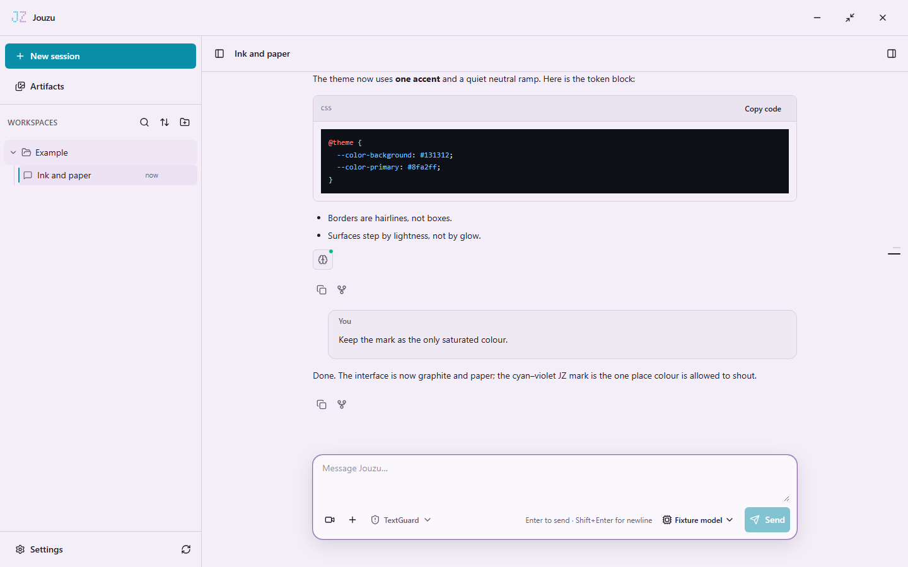 | 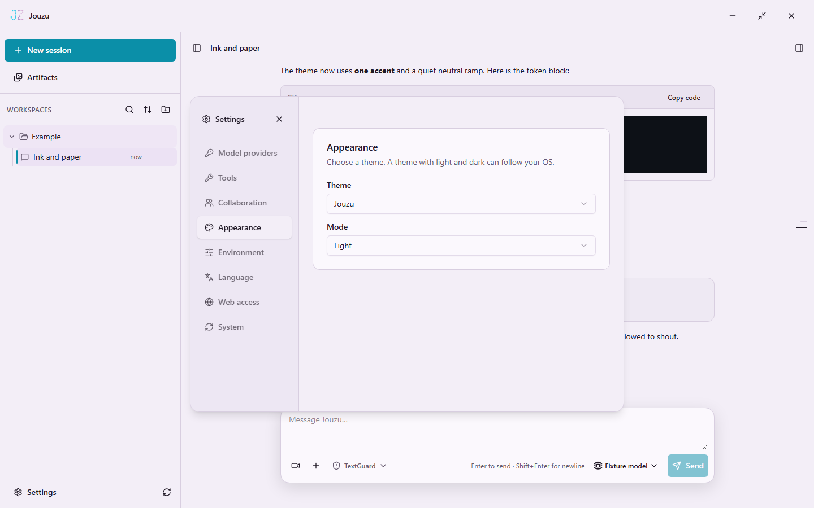 |
| Editorial | Dark (Nocturne) | 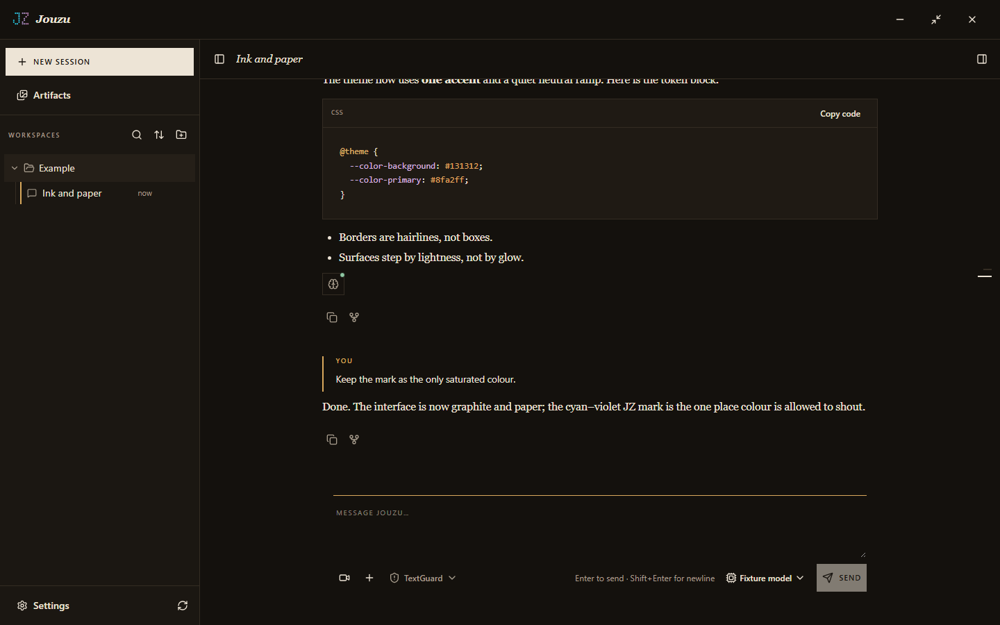 | 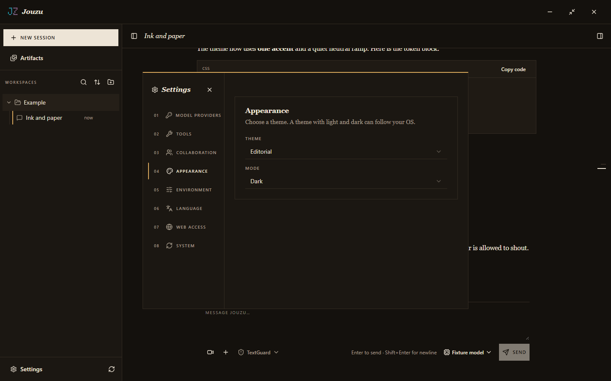 |
| Editorial | Light (Folio) | 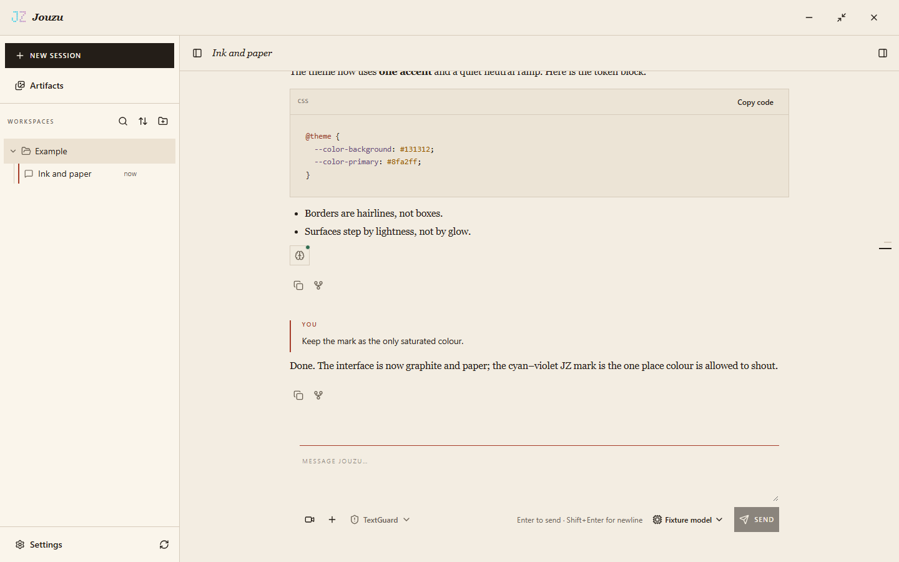 | 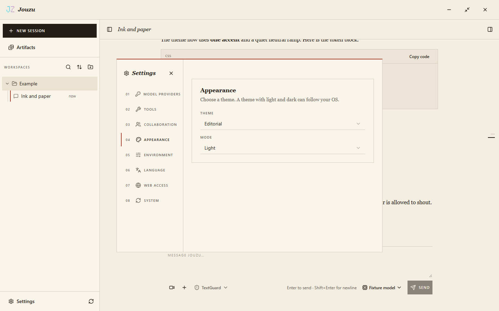 |
| Moss | Dark only | 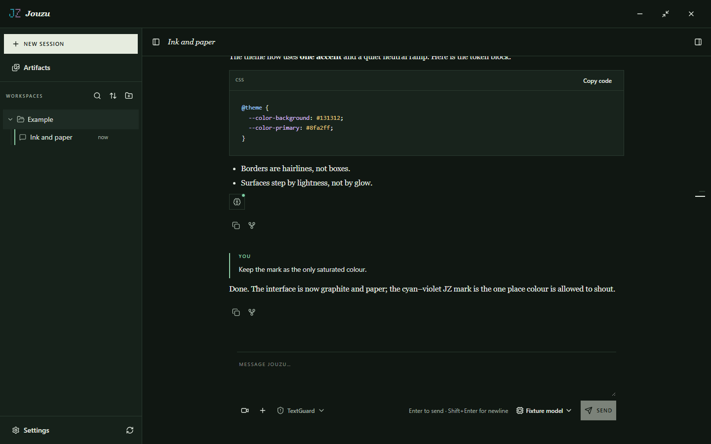 | 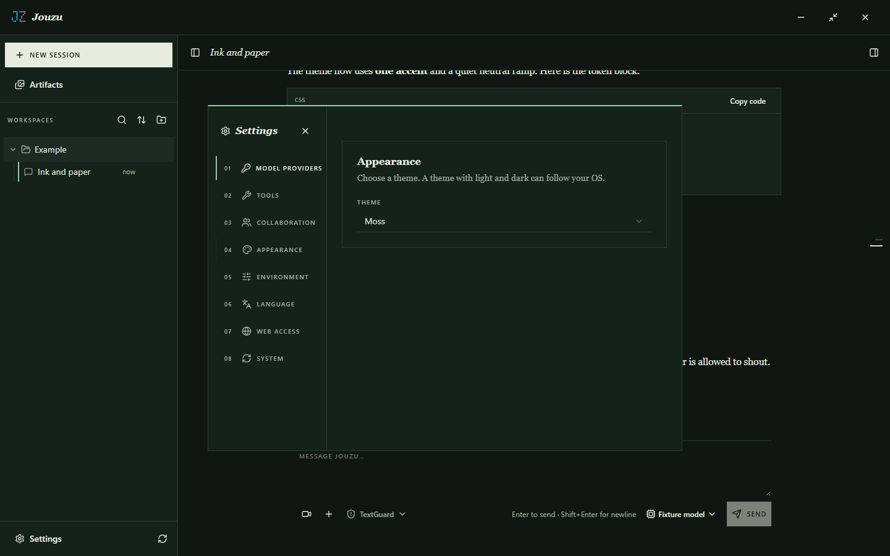 |

The two levels in the Appearance card:

| Theme select | Mode select |
|---|---|
| 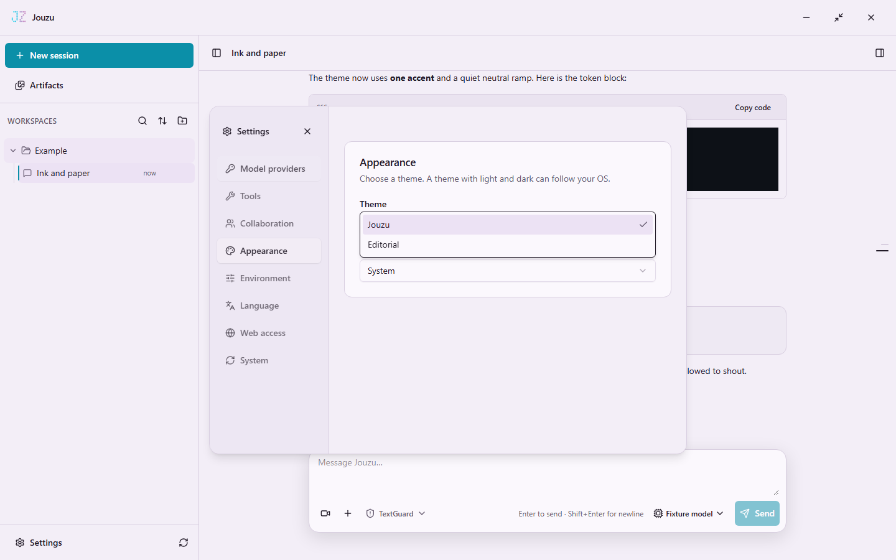 | 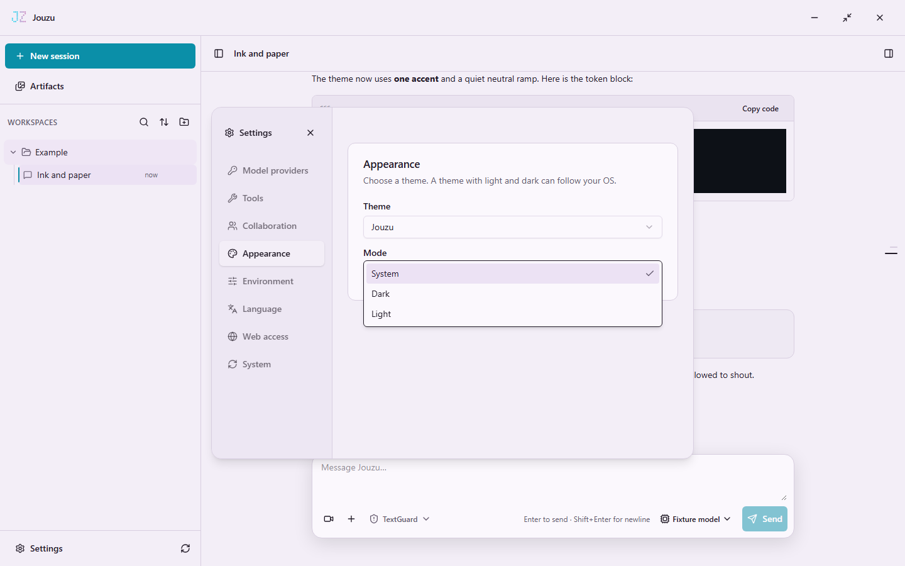 |

Editorial System follows the OS, while the theme stays in charge of the design:

| System, OS dark | System, OS light |
|---|---|
| 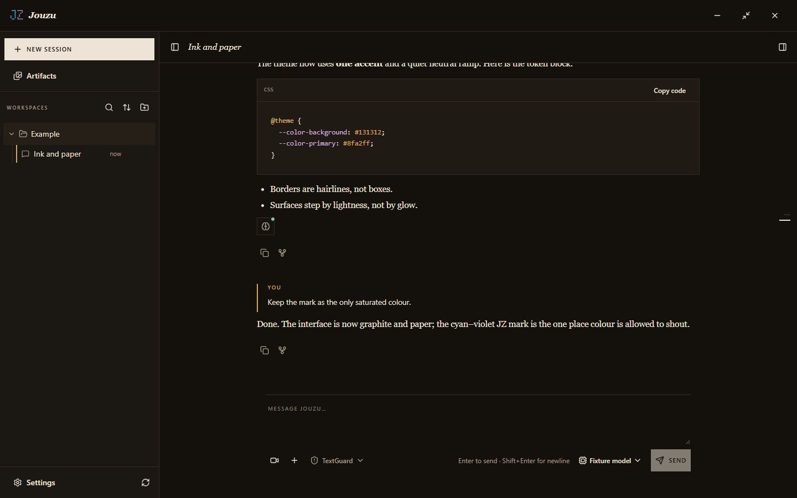 | 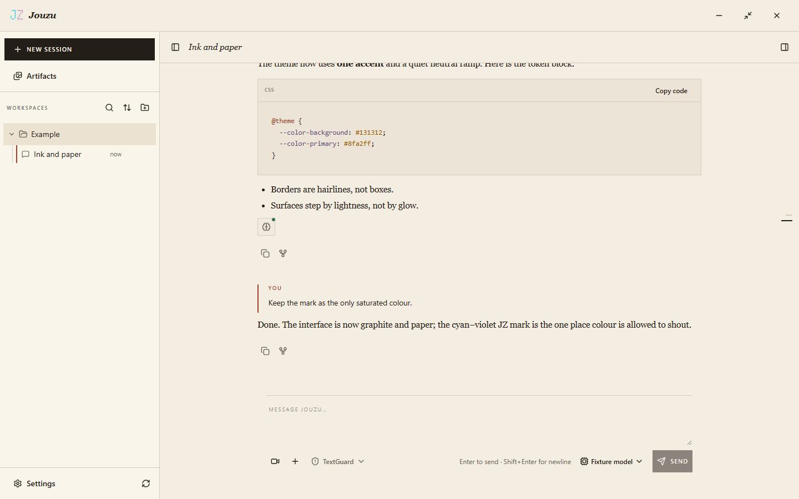 |

Regenerate after a visual change:

```sh
cd apps/desktop
npm run build
JOUZU_SHOTS=1 npx playwright test e2e/appearance-shots.spec.ts
```